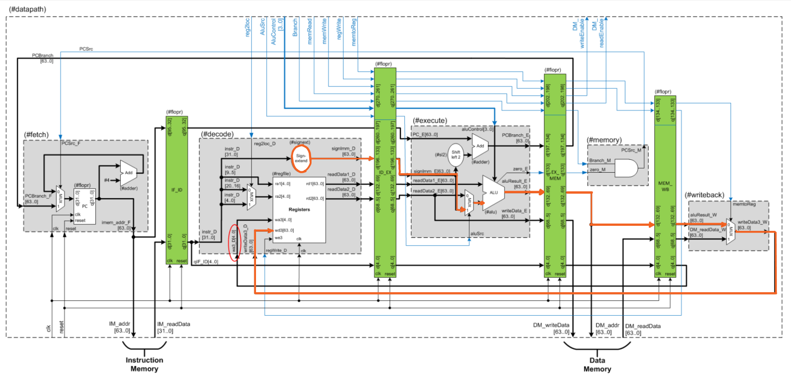
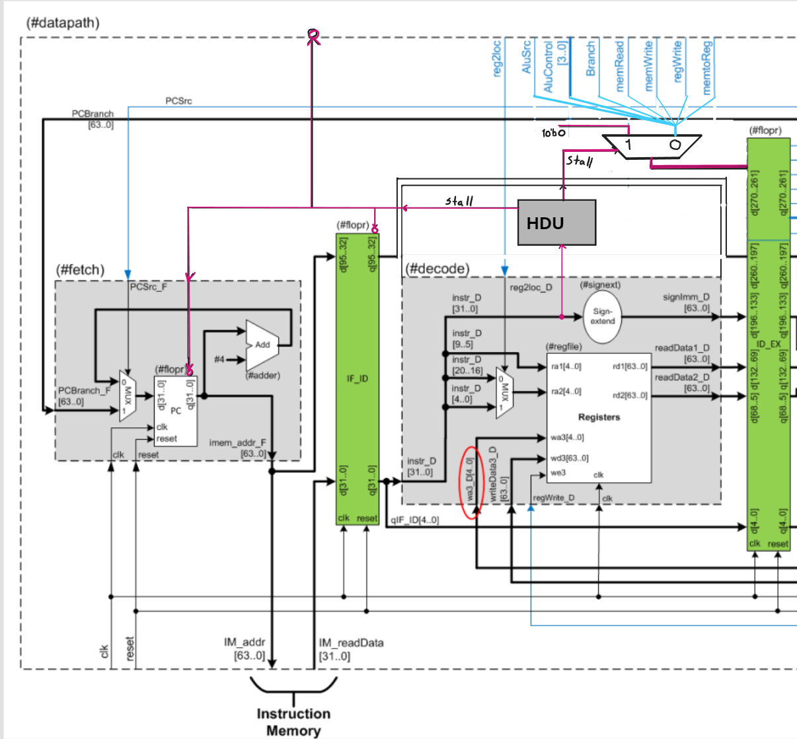
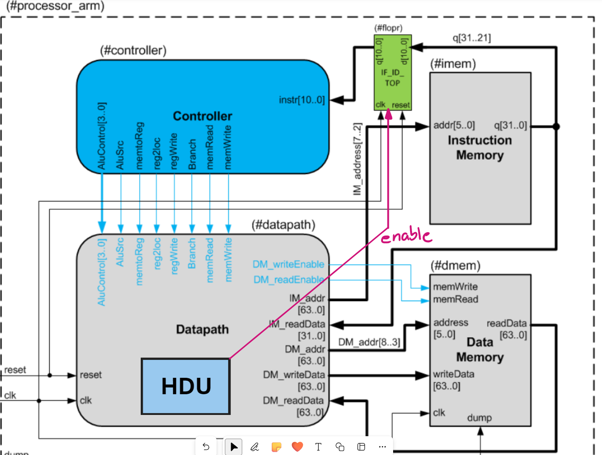
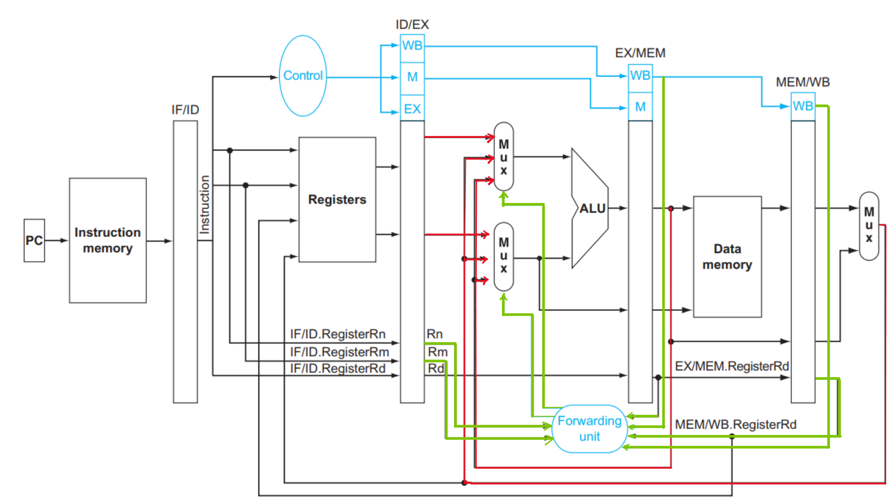
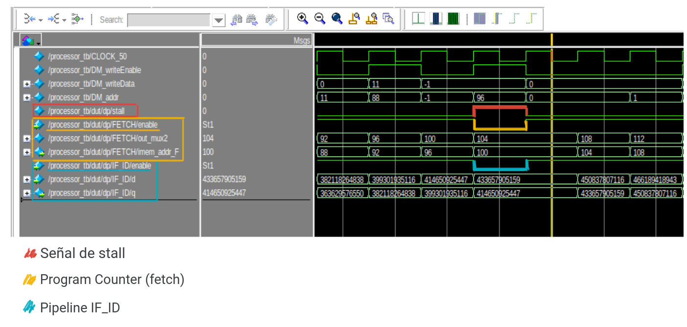
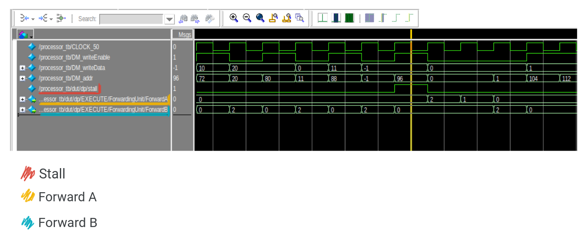

# **Laboratorio ARMv8 en SystemVerilog**

**Fecha de entrega:** martes 14 de noviembre

## Integrantes
- González Moreno, Juan Cruz
- Chesta, Lucas
- Solano, Florencia

# 1) Implementación de la Instrucción MOVZ en un Microprocesador con Pipeline

## Introducción
En el marco del proyecto, se ha llevado a cabo la implementación de la instrucción MOVZ en un microprocesador con pipeline. La instrucción MOVZ, que significa "Move wide with zero", permite cargar valores inmediatos en un registro, especificando la posición del valor inmediato mediante bits de desplazamiento LSL.

## Modificaciones Introducidas

### 1. Cambios en el Datapath

- Modificación en el módulo `signext`:
  
	Se realizó una modificación en el módulo `signext` para aprovechar su salida de 64 bits. Los bits `[15:0]` se utilizan para representar el inmediato, mientras que los bits `[63:62]` identifican el LSL. Esta adaptación permite un manejo eficiente de la información necesaria para la instrucción MOVZ.

- Modificación en el módulo `ALU`:

	Dentro del módulo `ALU`, se incorporó un caso adicional para la instrucción MOVZ. Cuando se detecta esta instrucción, se posicionan los bits según el LSL indicado, utilizando un desplazamiento correspondiente. El resto del proceso sigue la lógica estándar para cualquier operación de la ALU.

### 2. Cambios en el Controller

- Modificación en el módulo `maindec`:

	Se añadió un caso específico para la instrucción MOVZ. Se establecieron las señales de control de manera acorde al comportamiento de esta instrucción, configurando `RegWrite` para escribir el resultado en un registro, `ALUSrc` para utilizar la salida de `signext` como entrada en la `ALU`, y `ALUOp` con el valor 11, seleccionado arbitrariamente para diferenciar la instrucción MOVZ de las demás.

- Modificación en el módulo `aludec`:

	Se incorporó un caso adicional para la instrucción MOVZ. La salida `alucontrol` se ajustó con el valor 1000, seleccionado arbitrariamente para distinguir la instrucción MOVZ de las demás.

## Recorrido de la Instrucción MOVZ



## Verificación de la Implementación

Para verificar la correcta implementación, se agregaron al final del código proporcionado las siguientes instrucciones MOVZ con distintos valores numéricos y de LSL. 

```css
		MOVZ x9, #0xAAAA, lsl #00 
		STUR x9, [X30, #0]

		MOVZ X9, #0xBBBB, lsl #16
		STUR X9, [X30, #8]

		MOVZ X9, #0xCCCC, lsl #32
		STUR X9, [X30, #16]

		MOVZ X9, #0xDDDD, lsl #48
		STUR X9, [X30, #24]
```

Los resultados se compararon con los valores esperados almacenados en el archivo "mem.dump" al finalizar la ejecución del código.

## Resultados y Conclusiones
La instrucción MOVZ se integró exitosamente en el microprocesador con pipeline, manteniendo la funcionalidad de las instrucciones existentes. Las modificaciones en el datapath y en el controller se llevaron a cabo de manera coherente, y la verificación con programas de prueba confirmó el correcto funcionamiento del microprocesador ampliado.

# 2) Implementación de Hazard Detection Unit y Forwarding Unit en el Procesador LEGv8

## Introducción
En el marco de la evolución del procesador LEGv8, se ha implementado un bloque de Hazard Detection Unit (HDU) y otro de Forwarding Unit con el objetivo de abordar y gestionar de manera eficiente los data hazards en el procesador con pipeline. La técnica de forwarding-stall se ha aplicado para minimizar el impacto de estos hazards, permitiendo un flujo de ejecución más suave.

## Modificaciones Realizadas 

### 1. Hazard Detection Unit (HDU) en el Bloque Instruction Decode (ID):
   
Se implementó un bloque de Hazard Detection Unit (HDU) en la instancia del Instruction Decode (ID). Este bloque analiza las condiciones detalladas en el capítulo 4.7 del libro "Computer Organization and Design - ARM Edition" para detectar data hazards de distintos tipos. Las dependencias de datos se han considerado exhaustivamente para abordar situaciones de riesgo.




### 2. Forwarding Unit en el Bloque Execute (EX):

Se creó una nueva entidad denominada `Forwarding Unit` encargada de gestionar el forwarding de datos entre etapas del pipeline, contribuyendo así a la mitigación de data hazards. Esta unidad permite dirigir los datos adecuadamente para evitar stalls innecesarios.



La implementacion propia se hizo siguiendo estrictamente la propuesta del libro "Computer Organization and Design - ARM Edition" figura 4.55.

### 3. Nuevo Registro FLOPRE

Se diseñó un nuevo registro denominado `flopr_e`, similar al FLOPR pero con la adición de una señal de enable. Cuando el enable está activado (enable = 1), el `flopr_e` opera de manera normal; sin embargo, al detectar un flanco de CLK con enable desactivado (enable = 0), congela su valor y evita cambios en el pipeline.

Esta variacion se aplicó en el `flopr` del modulo `#fetch`. Su función principal es congelar el valor del Program Counter (PC) al surgir un stall. Asimismo, se aplicó esta variante en el pipeline IF_ID para preservar el valor de la instrucción cuando se presenta un stall, tanto en el interior del módulo #datapath como en el módulo `#processor_arm`.

### 4. Modificaciones del datapath

- `fetch.sv`: Se agregó el registro `flopr_e` y la señal `stall_out` para gestionar los stalls.

- `decode.sv`: Se añadieron los registros `rn_reg`, `rm_reg` y registros rd tanto de `IdEx` y `ExMem`, junto con las señales `MemRead` de los pipelines para gestionar las dependencias de datos en la HDU. Asimismo, se agregó el output `stall` de la HDU. 

- `execute.sv`: Incorporación de `ForwardingUnit` y ajustes en `mux3` para facilitar la transmisión de datos entre instrucciones. Ademas se agregaron todas las señales y registros indicados previamente para el funcionamiento de `ForwardingUnit`.

- `control_mux` : señales de control para el multiplexor de control de la unidad de forwarding.

## Verificación y Resultados
Se ejecutó el código proporcionado en el ejercicio 1 sin agregar instrucciones nop para evaluar el comportamiento del procesador con las nuevas implementaciones. Se tomaron capturas de pantalla de las formas de onda en ModelSim para ilustrar casos de stall y forwarding entre instrucciones.


Con rojo se indica la señal de stall, originada directamente de la Hazard Detection Unit (HDU). Con amarillo se indica el Program Counter (PC). Con azul se indica el flopr_e del pipeline IF_ID.

Este análisis visual revela claramente el comportamiento ante la ocurrencia de un stall. Durante este periodo, los enables de los flopr_e se desactivan, lo que tiene como consecuencia la congelación tanto del valor del PC como del contenido del pipeline IF_ID. Esta pausa en la ejecución, que ocurre durante un ciclo de reloj, evita que se produzcan errores en la ejecución por dependencias de datos.

### Stall entre instrucciones


```c
LDUR X12, [X0, #0]		//	F D E M W
ADD X7, X12, XZR		//	  F D E M W
```

En este caso, el LDUR tiene el dato disponible para la siguiente instruccion recien en la etapa de MEMORY (M) por lo tanto no puede hacer un forwarding hacia la etapa EXECUTE (E) de la siguiente instruccion. Por lo tanto, se produce un stall y luego un forwarding.

```c
LDUR X12, [X0, #0]		//	F D E M W
ADD X7, X12, XZR		//	  * F D E M W
```
De esta forma, la Forwarding Unit puede traer el dato actualizado desde la etapa de MEMORY (M) hacia la etapa de EXECUTE (E) de la siguiente instruccion.

### Forwarding entre instrucciones


Este análisis revela claramente como el código tiene muchas dependencias de datos, produciendo muchas situaciones de forwarding, ya sean de EXECUTE (E) hacia EXECUTE (E) activando la señales correspondiente de ForwardA o ForwardB en 10 (binario) segun sea registro RN o RM. Por otro lado, las dependencias de datos de MEMORY (M) hacia EXECUTE (E) se resuelven con la señales en 01 (binario). Finalmente, la señal default 00 (binario) implica que no hay dependencia de datos.

A continuacion se emplea un ejemplo de forwarding de EXECUTE (E) hacia EXECUTE (E).

```c
ADD X3, X4, X5			//	F D E M W
STUR X3, [X0, #24] 		//	  F D E M W
```
En este caso, la señal de ForwardB se setea en 10 (binario) para que se efectue el forwarding.

## Conclusiones
La implementación de Hazard Detection Unit y Forwarding Unit en el procesador LEGv8 ha demostrado ser efectiva para abordar data hazards y mejorar la eficiencia del pipeline. La combinación de forwarding y stall ha permitido gestionar de manera óptima las dependencias de datos, garantizando un flujo de ejecución suave y eficiente.

# 3) Implementación de flush en el Procesador LEGv8


